 

<table>
  <tr>
    <td valign="top"></td>
    <td valign="top" rowspan="2"></td>
  </tr>
  <tr>
    <td valign="top"></td>
  </tr>
</table>

# 💻 Tech Stack:
**Languages:**         
**Frontend:**      
**Backend & Data:**          
**Tools & Deployment:**         

<!-- Proudly created with GPRM ( https://gprm.itsvg.in ) -->
